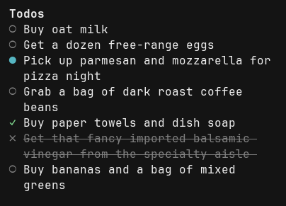

# opencode-todo

An opencode V2 plugin that restores v1-style todo-list functionality: a SQLite-backed
per-session todo store, `todowrite`/`todoread` agent tools, background housekeeping
(pruning todos for deleted sessions and auto-archiving completed items), and a TUI
sidebar component that surfaces the current session's todos inside the opencode
terminal interface.

opencode V2 intentionally removed the built-in todo feature (see
[anomalyco/opencode#42421](https://github.com/anomalyco/opencode/issues/42421)).
This plugin is a from-scratch replacement, V2-only, with no V1 compatibility layer.

## Installation

Add the package to your `opencode.json`/`opencode.jsonc` `plugins` array:

```jsonc
{
  "plugins": ["opencode-todo"],
}
```

The package exposes two entry points that load together automatically:

- `.` — the server plugin (`todowrite`/`todoread` tools, the SQLite store, housekeeping,
  and the `todo` RPC domain).
- `./tui` — the terminal-client plugin that renders the sidebar via the `sidebar.content`
  slot.

Both are picked up from a single `plugins` entry — no separate registration is needed
for the TUI half.

## Configuration

All options are optional; every one has a documented default. Set them under the
plugin's `options` object:

```jsonc
{
  "plugins": [
    {
      "package": "opencode-todo",
      "options": {
        "retentionDays": 7,
        "orphanGraceDays": 30,
        "sweepIntervalHours": 24,
        "dbPath": "/custom/path/todos.db",
        "busyTimeoutMs": 5000,
      },
    },
  ],
}
```

| Option               | Default                                                                                           | Meaning                                                                                                                                                                                                                                      |
| -------------------- | ------------------------------------------------------------------------------------------------- | -------------------------------------------------------------------------------------------------------------------------------------------------------------------------------------------------------------------------------------------- |
| `retentionDays`      | `7`                                                                                               | How long a `completed` item is kept after its `completed_at` timestamp before being archived (soft-deleted) by the housekeeping sweep.                                                                                                       |
| `orphanGraceDays`    | `30`                                                                                              | How long a session's todos are kept, with no further writes, before the age-based orphan sweep archives them. This is a pure elapsed-time check — the sweep never queries opencode for session liveness (see [Housekeeping](#housekeeping)). |
| `sweepIntervalHours` | `24`                                                                                              | Minimum time between opportunistic sweep passes. The sweep is piggybacked on `todowrite`/`todoread` calls, not run on a background timer — see below.                                                                                        |
| `dbPath`             | `$XDG_DATA_HOME/opencode-todo/todos.db` (falling back to `~/.local/share/opencode-todo/todos.db`) | Absolute path to the SQLite database file. Overridable per-invocation via the `OPENCODE_TODO_DB` environment variable, which takes precedence over the default but not over an explicit `dbPath` option.                                     |
| `busyTimeoutMs`      | `5000`                                                                                            | `PRAGMA busy_timeout` value, in milliseconds, applied to the SQLite connection. Relevant if multiple opencode server instances share one database file.                                                                                      |

An invalid value for `retentionDays`, `orphanGraceDays`, or `sweepIntervalHours` (not a
positive finite number) is logged as a warning and the default is used instead — it
never prevents the plugin from starting.

## Tools

### `todowrite`

Replaces the session's todo list with the given items. Each item may carry an `id` to
be recognised as the same item across calls (preserving its `created_at`/`completed_at`
history); an item with no `id` whose `content` exactly matches a still-open item from
the previous write is matched by content instead. Any previously-open item that the
model doesn't include in a `todowrite` call is archived (soft-deleted), not hard-deleted
— its data remains in the database, excluded from reads, until the retention/orphan
sweep or a manual database operation removes it permanently. An item's `status` is
optional and defaults to `pending` when omitted; an explicitly supplied value outside
`pending`/`in_progress`/`completed`/`cancelled` is still rejected.

Both `todowrite` and `todoread` return the current list as a compact JSON array
in their visible text, with stable `id`, `content`, `status`, and optional
`priority` fields. Empty lists return `[]`. A missing priority is omitted;
an empty-string priority is retained. For example:

```json
[
  {
    "id": "current-item-id",
    "content": "Verify the change",
    "status": "in_progress"
  }
]
```

Parse either tool's output, edit the items, and pass the full array back as
`todos` in an ordinary `todowrite` call. Retain each existing item's `id`, even
when renaming it, to preserve its identity and creation/completion history:

```json
{
  "todos": [
    {
      "id": "current-item-id",
      "content": "Verify the JSON output",
      "status": "completed"
    }
  ]
}
```

Use IDs from the latest output, not list positions or guesses. Omit `id` only
for genuinely new items. Timestamps and position remain in metadata, not in the
visible writable array.

An ID belonging to an archived item in the same session is rejected, including
with `freshList: true`. The error names the stale ID; the entire write fails
without changing the current list, archived history, or revision. Call `todoread`
to get current IDs, then resubmit the full intended list using a current item ID
or omitting the stale ID. Keep every current item you intend to retain. An
ordinary corrected retry against a preserved non-empty list reports
`listCreated: false`. Genuinely new IDs and IDs archived only in another session
remain valid.

Set the optional boolean `freshList` to `true` when starting a fresh task list while
a non-empty list already exists. You can carry unfinished items into that fresh
list by retaining their IDs; their history is preserved. Omit the flag (or use
`false`) for ordinary status changes, additions, removals, reordering, and other
updates. Non-boolean values are rejected before the list changes.

```json
{
  "freshList": true,
  "todos": [
    {
      "id": "existing-item-id",
      "content": "Carry unfinished work",
      "status": "in_progress"
    },
    { "content": "Start the next task" }
  ]
}
```

Successful non-empty writes report `metadata.listCreated: true` when the previous
non-archived list was empty or `freshList` is `true`, regardless of item statuses.
Completed and cancelled items still count as an existing list. Empty writes
always report `false`; clearing a list then writing a non-empty list reports
creation again, even with archived history.

This is a signal for the current operation, not persistent list identity or retry
deduplication: repeated non-empty writes with `freshList: true` each report
creation. Replacing every item in a non-empty list without the flag remains an
ordinary update and reports `false`.

### `todoread`

Returns the session's current, non-archived todo list. Its main value over reading the
transcript is surviving context compaction, where the original `todowrite` call's
output may no longer be present in the model's context window.

Both tools' results carry a `metadata` payload (`source`, `schemaVersion`, `sessionID`,
`revision`, `todos`, `counts`, boolean `listCreated`) alongside their JSON text, so other plugins
already watching `tool.execute.after` host-wide (for example a plugin deriving
conditions from todo state, such as `opencode-auto-instruct`) can reconstruct the full
todo state without a bespoke publish channel of their own.

`todoread` always reports `listCreated: false`. To react only to creation with
`opencode-auto-instruct`, use its existing scalar matcher:

```json
{
  "type": "dataEquals",
  "path": "listCreated",
  "value": true,
  "tool": "todowrite"
}
```

### Gating `todowrite`/`todoread` per agent

Both tool names are valid `permissions` action values like any other tool — there is no
platform limitation preventing this. To deny an agent (for example a narrowly-scoped
subagent) access to the todo tools:

```jsonc
{
  "agent": {
    "my-narrow-subagent": {
      "permissions": [
        { "action": "todowrite", "resource": "*", "effect": "deny" },
        { "action": "todoread", "resource": "*", "effect": "deny" },
      ],
    },
  },
}
```

## Housekeeping

Two independent mechanisms keep the database from growing unbounded, and neither one
ever queries opencode to check whether a session is "still alive":

- **Reactive pruning.** The server plugin subscribes to the `session.deleted` event and
  archives that session's todos immediately.
- **Opportunistic sweep.** Piggybacked on every `todowrite`/`todoread` call, gated by
  `sweepIntervalHours` so it runs at most once per interval. It archives (a) `completed`
  items older than `retentionDays` past their `completed_at`, and (b) every item
  belonging to a session with no writes in the last `orphanGraceDays` — purely by
  elapsed time, never by asking whether the session still exists. This is a deliberate
  design choice: a session-liveness lookup that returns a false negative (a paginated or
  transiently-failing listing call) would otherwise silently delete a live user's todos.

Archived items are soft-deleted (`archived_at` set), not hard-deleted, so a bug in the
sweep's window logic is recoverable rather than destructive.

## TUI Sidebar

The `./tui` entry point claims the `sidebar.content` slot and renders the focused
session's todo list, reading exclusively through the `todo` RPC domain — it never opens
the SQLite database directly. It re-fetches on session focus and again whenever a
`changed` RPC event is emitted for that session (after a `todowrite` call or a
housekeeping pass); it never polls. It renders nothing at all when the list is empty,
and degrades to a single inline text line (`todo: <message>`) if the RPC call fails, so
a broken plugin never blocks the rest of the terminal UI.



## Development

```bash
bun install
bun run test    # bun test --conditions=browser — required for Solid reactivity, see below
bunx tsc --noEmit
bunx eslint src/
```

`solid-js` resolves to its inert SSR build under Bun's default module-resolution
conditions (`createEffect` becomes a no-op). The `test` script always passes
`--conditions=browser` to force the real reactive build; running `bun test` directly
without that flag will silently produce a passing-looking but non-reactive test run for
any Solid-dependent test.
