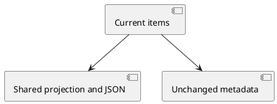

# Design

## Context

Both tools render ID-less checklists; metadata already contains complete `TodoItem[]`. Visible JSON enables exact ID reuse.

## Goals / Non-Goals

Enable direct round trips, including renames and escaped IDs. Storage, metadata, input schema, TUI, dependencies, and installed runtime remain unchanged.

## Decisions

- Both tools use the existing shared render helper for compact standard JSON: an ordered array containing only `id`, `content`, `status`, and optional `priority`. Empty lists produce `[]`; no envelope or surrounding prose.
- Omit `priority` only when null; retain every string value, including the empty string. Each visible item is directly compatible with the existing write input schema.
- Type the helper against existing `TodoItem` or a suitable `Pick`; no new model or component.
- Standard JSON escaping preserves exact IDs/content, including whitespace, quotes, and backslashes; no ID restrictions.
- Metadata retains full items, including `position`, `createdAt`, `updatedAt`, and `completedAt`; these read-only fields stay outside visible output.
- Descriptions and README explain passing the parsed array as `todos`, retaining IDs across updates/renames, and omitting IDs for new items.

## Risks / Tradeoffs

Full serialization avoids projection but exposes unnecessary fields and increases token cost. One small shared projection provides smaller, directly reusable output. Cost remains linear. Error handling and reread recovery remain unchanged; no migration.

Components: tools (application code): shared projection; tests (application tests): parsed round trips preserve identity/timestamps; README/delta (documentation/specification): matching visible contract.
